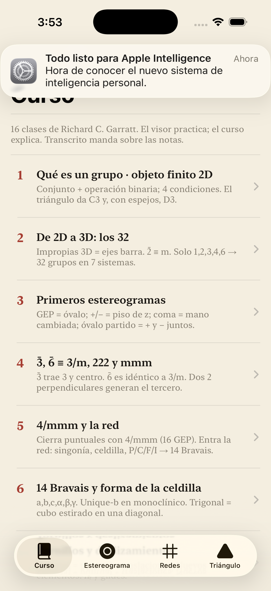
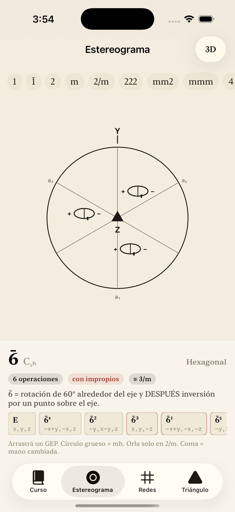
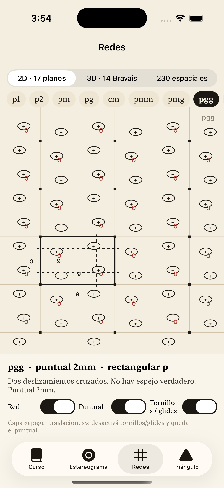
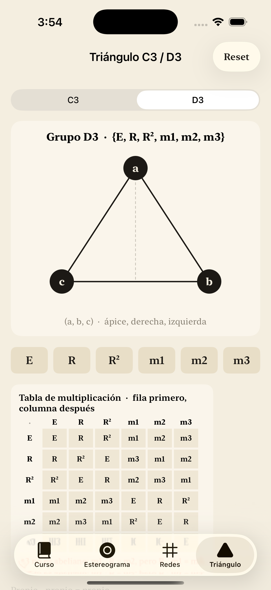

# symmetry-lab · Estereograma

Interactive **crystallographic point-group** lab for iPhone / iPad / Mac (SwiftUI).

Built for teaching protein crystallography symmetry: the **32 point groups**, stereograms, general equivalent positions (GEP), plane nets, and the classic triangle (C₃ / D₃) lab.

## What it does

| Tab | Content |
|---|---|
| **Curso** | Short lessons (group theory → 32 groups → stereogram conventions) |
| **Estereograma** | All 32 point groups · GEP · proper/improper ops · chiral vs centrosymmetric |
| **Redes** | 2D plane groups / nets (course companion) |
| **Triángulo** | C₃ / D₃ multiplication table lab |

Course conventions used here (unique monoclinic axis **b**, stereogram symbols, 6̄ ≡ 3/m) follow the crystallography teaching line used with the course materials (Garratt / lab notes).

## Screenshots

<p>
  
  
  
  
</p>

## Requirements

- macOS with **Xcode 15+** (SwiftUI)
- Run on **iOS Simulator**, iPhone/iPad, or Mac (Designed for iPad / multiplatform as configured in the project)

## Open & run

```bash
git clone https://github.com/Lv7s/symmetry-lab.git
cd symmetry-lab
open Estereograma.xcodeproj
```

In Xcode: choose an iPhone simulator → **Run** (⌘R).

If the Xcode project needs regeneration:

```bash
python3 make_xcodeproj.py
open Estereograma.xcodeproj
```

## Project layout

```
Estereograma/
  Engine/          # Groups, stereo math, nets, triangle algebra, 3D scene helpers
  Views/           # SwiftUI tabs
  Course/          # Lesson catalog
  ContentView.swift
  EstereogramaApp.swift
Estereograma.xcodeproj/
docs/screenshots/
```

## Author

**Luis Alberto Valverde F.** · GitHub [@Lv7s](https://github.com/Lv7s)

Structural biology / septins · crystallography teaching tools.

## License

MIT — see [LICENSE](LICENSE).

## Related

A separate web/PWA prototype of the same teaching ideas may appear later; this repo is the **native Swift** app.
